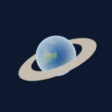
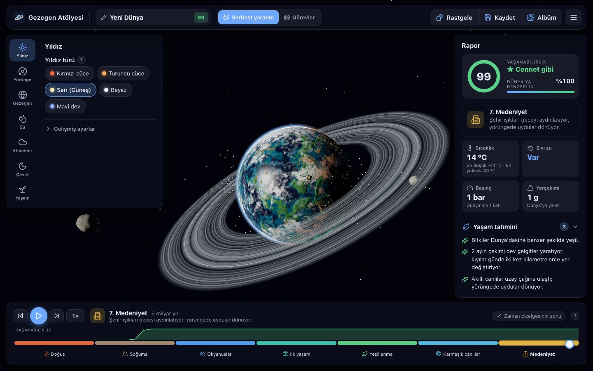
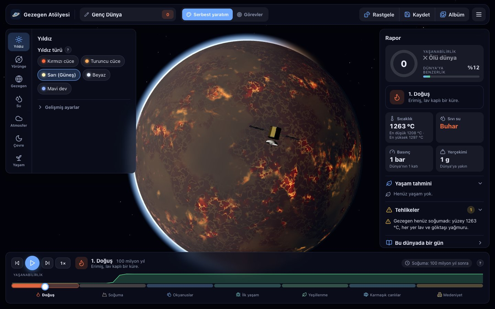
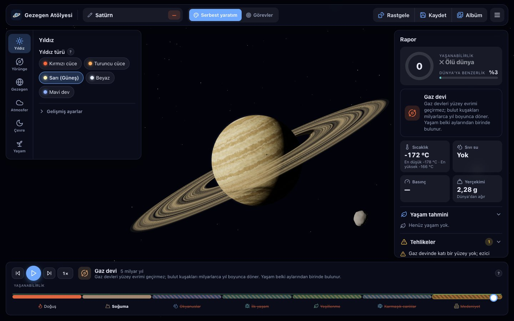
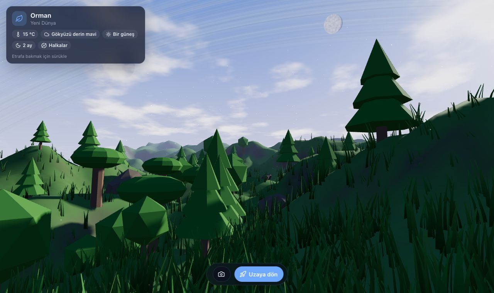
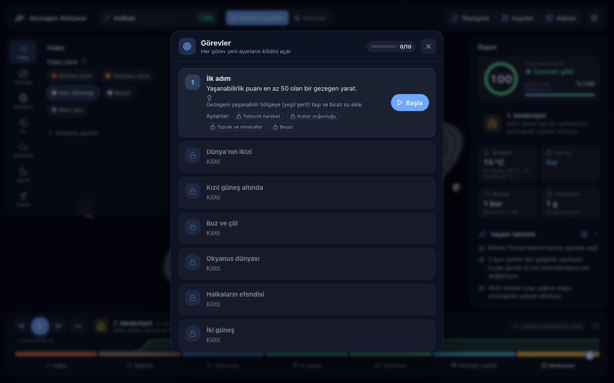

<div align="center">



# Gezegen Atölyesi

**Kendi gezegenini yarat, yaşamın doğuşunu izle.**<br/>
Tarayıcıda çalışan, açık kaynaklı, prosedürel bir gezegen yaratma ve evrim simülasyonu oyunu.

*Create your own planet and watch life evolve on it: an open-source procedural planet sandbox for the web.*

### [🚀 Hemen oyna → gezegen-atolyesi.netlify.app](https://gezegen-atolyesi.netlify.app)
<sub>Kurulum yok · ücretsiz · telefonda da çalışır · <a href="https://gezegen-atolyesi.netlify.app">Play now</a></sub>

[](https://gezegen-atolyesi.netlify.app)
[](https://app.netlify.com/projects/gezegen-atolyesi/deploys)
[](LICENSE)
[](https://github.com/MesutYilmazJS/gezegen-atolyesi/actions/workflows/ci.yml)


[](CONTRIBUTING.md)

[Özellikler](#özellikler) · [Hızlı başlangıç](#hızlı-başlangıç) · [Nasıl çalışır](#nasıl-çalışır) · [Yol haritası](#yol-haritası) · [Katkı](#katkıda-bulun) · [English](#english)

<a href="https://gezegen-atolyesi.netlify.app"></a>

</div>

## Nedir?

Gezegen Atölyesi'nde bir yıldız seçer, gezegenini ayarlarla şekillendirir ve 5 milyar yıllık evrimini izlersin. Lav dolu bir küre olarak doğan gezegen soğur, okyanuslar oluşur ve koşullar uygunsa yaşam ortaya çıkar: önce mikroplar, sonra ormanlar, karmaşık canlılar ve sonunda gece tarafında parlayan şehir ışıkları.

Her ayarın arkasında basitleştirilmiş ama gerçek bilime dayanan hesaplar var: yıldız parlaklığı ve uzaklıktan denge sıcaklığı, sera etkisi, suyun sıvı kalabildiği basınç ve sıcaklık aralığı, Dünya Benzerlik İndeksi (ESI). Oyun hem eğlenceli bir sandbox hem de **astronomi ve gezegen bilimi için eğitici bir araçtır**.

<table>
<tr>
<td width="50%"><br/><sub><b>Doğuş:</b> lav okyanusları ve soğuyan kabuk</sub></td>
<td width="50%"><br/><sub><b>Gerçek gezegenler:</b> Satürn'ün bantları ve halkaları</sub></td>
</tr>
<tr>
<td width="50%"><br/><sub><b>Yüzeyden bak:</b> gökyüzünü kesen halkalar ve iki ay</sub></td>
<td width="50%"><br/><sub><b>Görevler:</b> her görev yeni ayarların kilidini açar</sub></td>
</tr>
</table>

## Özellikler

**Gezegen yaratma**
- Kodla, canlı üretilen 3B gezegen (Three.js + GLSL): prosedürel kıtalar, okyanuslar, buzullar, çöller, ormanlar, dağ gölgeleri
- Bulutlar, fırtına girdapları, atmosfer halesi, kutup ışıkları, lav ışıltısı, gece tarafında şehir ışıkları
- Kayalık gezegenler ve gaz devleri (bantlar, dev leke, şimşekler), halkalar ve halka gölgeleri, düzensiz aylar
- 30'dan fazla ayar: yıldız türü, çift yıldız, yörünge şekli, eksen eğikliği, gün uzunluğu, kilitli dönüş, tektonik, volkanizma, mineraller, su ve okyanus türü (tatlı, tuzlu, sıvı metan), atmosfer bileşimi, manyetik alan…

**Simülasyon**
- Yaşam raporu: sıcaklıklar, sıvı su, basınç, yerçekimi, yaşanabilirlik puanı, Dünya'ya benzerlik, yaşam tahmini, tehlikeler ve "bu dünyada bir gün" hikâyesi
- Evrim zaman çizelgesi: Doğuş → Soğuma → Okyanuslar → İlk yaşam → Yeşillenme → Karmaşık canlılar → Medeniyet; koşullar uygun değilse evrim takılır ve nedeni söylenir
- Felaketler: göktaşı çarpması, süper volkan, buzul çağı, yıldız patlaması, sera etkisi kaçağı; yaşamın toparlanması zaman çizelgesinde

**Oyun**
- Görev modu (10 görev, kilit açma), 8 rozet, 21 maddelik ansiklopedi
- Gerçek gezegenler: Merkür, Venüs, Dünya, Mars, Jüpiter, Satürn, TRAPPIST-1e, Proxima b, Kepler-452b
- Yüzeyden bak modu, fotoğraf modu, Web Audio ile üretilen müzik ve ses efektleri
- Gezegen albümü, rastgele gezegen

**Her cihazda**
- Masaüstü, tablet ve telefon; dokunmatik kontroller
- PWA: ana ekrana eklenebilir, internetsiz çalışır
- Otomatik grafik kalitesi, pil tasarrufu, hareketi azalt, büyük yazı, açık/koyu tema

## Hızlı başlangıç

Sadece oynamak istiyorsan hiçbir şey kurmana gerek yok: **[gezegen-atolyesi.netlify.app](https://gezegen-atolyesi.netlify.app)**. Telefonda "Ana ekrana ekle" dersen uygulama gibi açılır ve internetsiz de çalışır.

Kendi bilgisayarında geliştirmek için gereksinim: [Node.js](https://nodejs.org/) 20 veya üstü.

```bash
git clone https://github.com/MesutYilmazJS/gezegen-atolyesi.git
cd gezegen-atolyesi
npm install
npm run dev
```

Tarayıcıda `http://localhost:5173` adresini aç. Aynı ağdaki telefondan da açabilirsin (`--host` açık).

| Komut | Açıklama |
| --- | --- |
| `npm run dev` | Geliştirme sunucusu |
| `npm run build` | Tür denetimi + üretim derlemesi (`dist/`) |
| `npm run preview` | Üretim derlemesini yerelde sun |
| `npm run blender` | 3B modelleri, rozetleri ve simgeleri Blender ile yeniden üret |

### Klavye kısayolları

`R` rastgele gezegen · `S` kaydet · `A` albüm · `G` görevler · `Y` yüzeyden bak · `P` fotoğraf modu · `Boşluk` zamanı oynat · `← →` zamanda ilerle · `F` odaklan · `H` arayüzü gizle

## Nasıl çalışır

```
src/
├── sim/        Fizik: sıcaklık, sera etkisi, su durumu, yaşanabilirlik, evrim, felaketler
├── render/     Three.js sahnesi, gezegen sistemi, yüzey görünümü
│   └── shaders/  Yüzey "pişirme", gezegen, bulut, atmosfer, halka ve gaz devi GLSL kodları
├── game/       Görevler, rozetler, ansiklopedi, gerçek gezegenler, ilerleme kaydı
├── ui/         Ayar paneli, rapor, zaman çizelgesi, pencereler, ikonlar (Lucide)
├── audio/      Web Audio ile üretilen müzik ve efektler
├── state/      Ayarlar ve tarayıcı kaydı
└── i18n/       Tüm arayüz metinleri (tek dosyada; yeni dil eklemek kolay)
blender/        Modelleri, manzaraları ve rozetleri üreten Blender (bpy) betikleri
```

- **Yüzey pişirme:** Gezegen yüzeyi yalnızca tohum ya da tektonik değişince gürültü fonksiyonlarıyla bir dokuya "pişirilir"; her karede sadece bu doku okunur. Bu sayede telefonda da akıcı çalışır.
- **Su miktarı = alan:** Pişirilen yükseklik dağılımı ölçülür, "%71 su" gerçekten yüzeyin %71'ini kaplar.
- **Basitleştirilmiş bilim:** Denge sıcaklığı `T = 278,6 · (L·(1−A))^¼ / √d`, basınca ve bileşime bağlı sera etkisi, Clausius–Clapeyron ile kaynama noktası, Dünya Benzerlik İndeksi.
- **Blender:** Gezegen her zaman kodla üretilir; aylar, göktaşı, uzay sondası, yüzey manzaraları ve rozetler Blender betikleriyle üretilir ve Draco ile sıkıştırılmış GLB olarak yüklenir.

## Yol haritası

- [x] **Sürüm 1:** Çekirdek oyun: 3B gezegen, temel ayarlar, yaşam raporu, zaman çizelgesi, kayıt, PWA
- [x] **Sürüm 2:** Oyunlaştırma: kalan ayarlar, görevler, rozetler, ansiklopedi, gerçek gezegenler, felaketler, yüzey görünümü, fotoğraf modu, ses
- [ ] **Sürüm 3:** Sosyal: link ile paylaşım ve paylaşım kartı, günün gezegeni, hesap sistemi ve bulut kayıt, topluluk galerisi, İngilizce dil desteği (canlı yayın ✓)

Tam tasarım belgesi: [TASARIM.md](TASARIM.md)

## Katkıda bulun

Her türlü katkıya açığız: hata bildirimi, yeni özellik, çeviri, bilimsel düzeltme, yeni gerçek gezegen, Blender modeli…

1. [Açık işlere](https://github.com/MesutYilmazJS/gezegen-atolyesi/issues) göz at; `good first issue` etiketliler başlamak için ideal.
2. [Katkı rehberini](CONTRIBUTING.md) oku.
3. Repoyu fork'la, bir dal aç, değişikliğini yap ve pull request gönder.

Projeyi beğendiysen bir ⭐ vermeyi unutma; daha çok kişinin keşfetmesine yardım eder.

## Lisans

[MIT](LICENSE). Özgürce kullanabilir, değiştirebilir ve dağıtabilirsin.

---

## English

**Gezegen Atölyesi** ("Planet Workshop") is an open-source, browser-based **procedural planet generator and evolution sandbox** built with **Three.js, WebGL/GLSL and TypeScript**.

Pick a star, shape your planet with 30+ parameters (distance, water, atmosphere composition, tectonics, magnetic field, rings, moons…) and watch 5 billion years of evolution, from a molten lava world to oceans, microbes, forests and city lights. A simplified but science-based model computes equilibrium temperature, greenhouse effect, liquid-water range, habitability and the Earth Similarity Index.

**Highlights:** procedural terrain baked on the GPU · gas giants with bands and storms · rings with shadows · disasters (asteroid impact, supervolcano, ice age, stellar flare, runaway greenhouse) · missions, badges and an encyclopedia · real planets (Mercury to Kepler-452b) · surface view with a sky showing your rings and moons · photo mode · generative Web Audio music · installable PWA that works offline · mobile and touch friendly.

**Play it now: [https://gezegen-atolyesi.netlify.app](https://gezegen-atolyesi.netlify.app)** (no install, works on phones, offline-capable).

```bash
npm install && npm run dev
```

The UI is currently in Turkish; all strings live in a single file ([`src/i18n/tr.ts`](src/i18n/tr.ts)), so **an English translation is a great first contribution**. See [CONTRIBUTING.md](CONTRIBUTING.md).

<sub>Anahtar kelimeler / keywords: gezegen oluşturucu, gezegen simülasyonu, uzay oyunu, astronomi, eğitici oyun, yaşanabilir bölge, ötegezegen, evrim, procedural planet generator, planet simulator, space sandbox, exoplanets, habitability, worldbuilding, threejs, webgl, glsl shaders, typescript, vite, pwa, blender, educational game, browser game.</sub>
